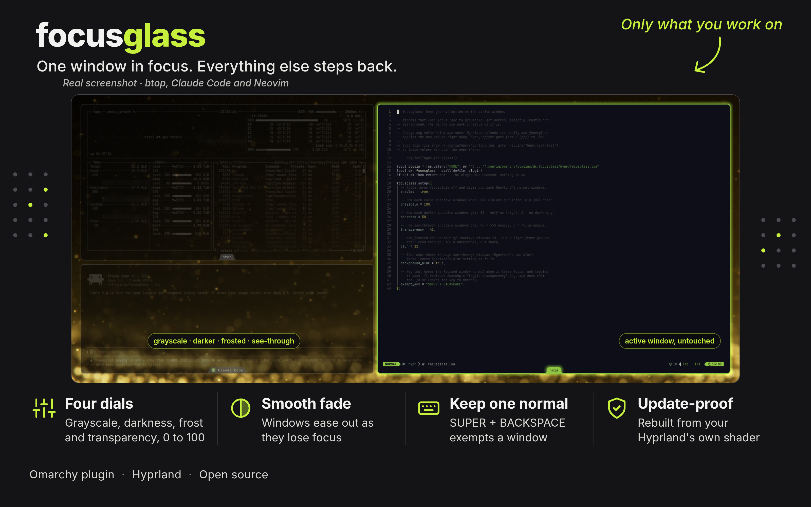

# focusglass

Keeps your attention on the window you are working in. Every other window fades
to grayscale, gets darker, slightly frosted and see-through, so the active one
is the only thing on screen in full color and full brightness.



Each effect is a number from 0 (off) to 100 in one settings file, and you can
keep any single window normal with a key.

Built for Hyprland 0.56 with the Lua config (Omarchy).

## Install

### On Omarchy

```sh
omarchy plugin add https://github.com/dobrician/focusglass --enable
```

Or find it in the Omarchy plugin marketplace. The first time the plugin runs it
opens a terminal that:

1. adds your settings file, `~/.config/hypr/focusglass.lua`, and
2. asks to load it from `~/.config/hypr/hyprland.lua`, right after
   `require("hypr.looknfeel")`, so its values win over the ones there.

You can run that step yourself at any time:

```sh
bash ~/.config/omarchy/plugins/dc.focusglass/omarchy/focusglass-setup install
```

## Settings

Everything is in `~/.config/hypr/focusglass.lua`. Change a value and save:
Hyprland reloads its config and the new look applies right away.

```lua
focusglass.setup({
  enabled         = true,
  grayscale       = 100,
  darkness        = 50,
  transparency    = 45,
  blur            = 12,
  background_blur = true,
  exempt_key      = "SUPER + BACKSPACE",
})
```

| Setting | Default | What it does |
|---|---|---|
| `enabled` | `true` | `false` turns focusglass off and gives you Hyprland's normal windows back. |
| `grayscale` | `100` | How much color inactive windows lose. `100` is black and white, `0` keeps full color. |
| `darkness` | `50` | How much darker inactive windows get. `50` is half as bright, `0` is no darkening. |
| `transparency` | `45` | How see-through inactive windows are. `45` leaves them 55% opaque, `0` keeps them opaque. |
| `blur` | `12` | How frosted the content of inactive windows is. `12` is a light frost you can still read through, `100` is unreadable, `0` is sharp. |
| `background_blur` | `true` | Blurs what shows through see-through windows, with Hyprland's own blur. `false` leaves Hyprland's blur setting as it is. |
| `exempt_key` | `"SUPER + BACKSPACE"` | Keeps the focused window normal when it loses focus; press it again to undo. `false` leaves the key alone. |

Any number from 0 to 100 works, and every effect can be turned off on its own
by setting it to `0`. A setting focusglass doesn't know, or a value out of
range, shows up as a notification with what it used instead.

Some combinations:

```lua
-- only fade the colors
focusglass.setup({ darkness = 0, transparency = 0, blur = 0 })

-- dark, opaque background windows
focusglass.setup({ grayscale = 0, darkness = 60, transparency = 0, blur = 0 })

-- strong frosted glass
focusglass.setup({ darkness = 30, transparency = 55, blur = 40 })
```

### Keeping one window normal

Say you write code and want the browser next to it to stay readable. Focus the
browser and press `SUPER + BACKSPACE`: it stays opaque, in color and at full
brightness when you go back to the editor. Press it again on the same window to
put it back under focusglass.

On Omarchy, `SUPER + BACKSPACE` already toggles a window's transparency;
focusglass's key does that and turns its own effect off or on along with it.
For a window that is opaque by Omarchy's window rules, the first press makes it
see-through, so it may take two presses to get it normal.

## How it works

Hyprland has no per-window color filter. The one per-window value its window
shader gets is the *dim* of an inactive window, used by `dim_inactive`.
focusglass turns dimming on and writes a patched copy of Hyprland's window
shader to `~/.config/hypr/shaders/surface.frag`, a file Hyprland loads in place
of its own. In that copy, the dim value no longer darkens a window; it says how
inactive the window is, and grayscale, darkness and frost follow it. Because it
rides on Hyprland's dim, the change animates with Hyprland's `fadeDim`
animation, and windows Hyprland never dims (`no_dim`) are left alone.

Your settings file runs the plugin only while it is enabled in Omarchy, which
lists enabled plugins in `~/.config/omarchy/shell.json`. After
`omarchy plugin disable dc.focusglass` (or `remove`), the settings file stops
there: it deletes the shader copy focusglass wrote and runs nothing from the
plugin folder, and Hyprland reloads its config so windows look normal right
away. Enabling the plugin again turns focusglass back on.

A settings file made by focusglass 0.1.0 did not have this check. The plugin
updates it the next time it loads: it keeps your values, puts the check in,
saves the old file as `focusglass.lua.bak.focusglass-0.1.0`, and does nothing
while the plugin is disabled.

Transparency and the background blur are plain Hyprland settings
(`inactive_opacity` and `decoration:blur`), set by focusglass from your values.

The shader copy is made from the shader of the Hyprland you have installed
(`/usr/include/hyprland/src/render/shaders/surface.frag.inc`, part of the
`hyprland` package), every time the config loads, so it follows Hyprland
updates. If a future Hyprland changes that shader so focusglass no longer
recognizes it, focusglass deletes its copy, sends a notification, and windows
look normal until focusglass is updated.

focusglass never overwrites a `surface.frag` it did not write. If you already
have your own shader there, it stays off and tells you.

### Things to know

- focusglass takes over `dim_inactive` and `dim_strength`. Hyprland's plain
  dimming is replaced by the `darkness` setting.
- A window that stops responding is grayed out like an inactive one, since
  Hyprland signals it through the same dim value.
- `background_blur` turns on Hyprland's blur for everything see-through, not
  only for inactive windows, and costs a little GPU.
- After a Hyprland update, focusglass keeps the previous shader until you log
  out and back in, so it never mixes the shader of one version with another.

## Uninstall

```sh
bash ~/.config/omarchy/plugins/dc.focusglass/omarchy/focusglass-setup uninstall
omarchy plugin remove dc.focusglass
```

The first command stops loading focusglass from `hyprland.lua` and deletes its
shader copy, so Hyprland draws windows with its own shader again. It leaves
`~/.config/hypr/focusglass.lua` in place; delete it if you don't want it. If you
only disable or remove the plugin, the settings file sees that, deletes the
shader copy and does nothing else.

## Tests

```sh
lua tests/test_patch.lua
lua tests/test_example.lua
```

The first patches the installed Hyprland shader with the default settings and
checks the result, the settings validation, and that an unknown shader is
refused. The second checks that the settings file runs the plugin only while
Omarchy lists it as enabled, that when it is off it deletes only a shader
focusglass wrote, and that a settings file from 0.1.0 is updated.
